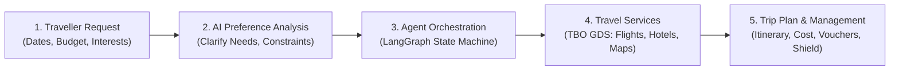

# 🌍 WanderWise — Virtual Travel Agent & Travel Agent Copilot
> **A complete travel journey, powered by one AI Agent.**  
> *From "Where should I go?" to "Your trip is ready."*

---

### 🏆 VoyageHack 4.0 by TBO.com
* **Problem Statement:** Virtual Travel Agent – Travel Agent Copilot
* **Team Name:** **INVICTUS**
* **Team Leader:** Rongali Nandika Laxmi Narayani
* **Team Member:** Rahul Pujari
* **Institution:** Institute of Aeronautical Engineering (IARE)

---

## 💡 Executive Summary & Solution Overview

Travel planning today is fragmented across dozens of disconnected tabs, opaque pricing models, rigid booking systems, and zero continuity once a booking is confirmed. 

**WanderWise** solves this by unifying the entire travel lifecycle into a single autonomous AI agent and interactive copilot. Built for both end travellers and modern travel agents, WanderWise asks relevant questions, understands nuanced preferences and constraints, compares options in real time, optimizes total trip budgets, issues verified travel vouchers, and provides continuous 24/7 post-booking disruption protection.

---

## 🎯 The 6 Core Pillars (Slide 2 Implementation)

WanderWise directly delivers the 6 foundational pillars specified in the submission deck:

| Pillar | Capability | MVP Implementation Highlights |
| :--- | :--- | :--- |
| **01. Conversational Discovery** | Destination, dates, budget, interests & constraints | Natural language chat copilot extracting intent, traveler persona, duration, and constraints with instant suggestion pills. |
| **02. Travel Option Comparison** | Compares flights, hotels, transfers & experiences | Side-by-side multi-inventory cards displaying airlines, baggage allowances, cancellation rules, star ratings, and 1-click option swapping. |
| **03. Personalized Itinerary** | Day-wise plans built around traveller preferences | Timeline structured into Morning, Afternoon, and Evening slots with real-time weather forecasts, duration, costs, and local insider pro-tips. |
| **04. Cost Estimation** | Calculates trip costs and suggests budget-aware alternatives | Visual budget tracker gauge (flights + hotels + transfers + activities + buffer) paired with automated AI savings recommendations (e.g. swap hotels to save $160). |
| **05. Booking Companion** | Retrieves confirmations, reservations and vouchers | Instant booking flow generating verifiable PNR codes, hotel confirmation numbers, support PINs, and printable/downloadable travel vouchers. |
| **06. Post-Booking Support** | Assists with changes, cancellations and disruptions | Autonomous disruption shield that detects flight delays, re-schedules airport chauffeurs, alerts hotel front desks, and issues terminal lounge passes. |

---

## ⚙️ Technical Approach & Architecture (Slide 3)

### End-to-End Workflow Pipeline:


### Proposed & Implemented Tech Stack:
* **Frontend:** React 19, Vite 8, Tailwind CSS, Lucide Icons, Glassmorphic responsive interface
* **Backend:** Python 3.10+, FastAPI (Async REST APIs)
* **Agent Workflow & Orchestration:** LangGraph state machine with 5-stage reasoning steps
* **Data & Distribution Services:** Modeled after TBO Global Distribution System (GDS) multi-inventory architecture
* **Integrations:** Travel inventory, weather forecast simulation, live disruption monitor

---

## 🌟 Expected Impact (Slide 3)

1. **Less Effort:** Consolidates flight search, hotel booking, local transit, and day planning into a 2-minute conversation, eliminating hours of manual research across 10+ tabs.
2. **Better Fit:** Recommendations dynamically adjust to personal preferences (pace, culinary interests, cultural sights, accessibility).
3. **Cost Clarity:** Complete transparency over the entire trip cost upfront, preventing hidden surprises and actively proposing budget-saving alternatives.
4. **Trip Continuity:** Unlike traditional OTAs that stop at the checkout page, WanderWise acts as a continuous digital concierge throughout the journey.

---

## 🚀 Quick Start Guide (Running the MVP)

### Prerequisites:
* Python 3.10 or higher
* Node.js v18+ and npm (optional for dev mode; pre-built production assets are already included!)

---

### Option 1: 1-Click Launch (Backend + Embedded Frontend)
The FastAPI backend is configured to serve the complete, production-built React frontend directly:

```bash
# In the root c:\WanderWise directory:
run.bat
```
*Or via terminal:*
```bash
cd backend
python -m uvicorn main:app --reload --host 127.0.0.1 --port 8000
```
👉 Open your browser to **http://127.0.0.1:8000** to experience WanderWise live!

---

### Option 2: Full Development Mode (Hot Reloading)

**Terminal 1 — FastAPI Backend:**
```bash
cd backend
python -m uvicorn main:app --reload --host 127.0.0.1 --port 8000
```

**Terminal 2 — Vite React Frontend:**
```bash
cd frontend
npm run dev
```
👉 Open your browser to **http://localhost:5173** for real-time frontend hot reloading.

---

## 🧪 Interactive Judges Walkthrough Guide

To verify each feature in the MVP during evaluation:

1. **Test Conversational Discovery (Pillar 1):**
   * Click any quick prompt chip (e.g. `🗼 Tokyo 4-day plan ($2500)` or `🏖️ Goa beach vacation`).
   * Watch the AI Copilot immediately extract intent and update the entire plan.
2. **Test Travel Option Comparison (Pillar 2):**
   * Open the **"Travel Option Comparison"** tab.
   * Switch between ANA, Singapore Airlines, or JAL flights, and explore 4★ vs 5★ hotels.
   * Click **"Choose Flight"** or **"Select Hotel"** to see costs auto-recalculate in real-time.
3. **Test Personalized Itinerary (Pillar 3):**
   * Open the **"Personalized Itinerary"** tab.
   * Toggle between Day 1, Day 2, Day 3, and Day 4 to view morning/afternoon/evening schedules, weather badges, and insider pro-tips.
4. **Test Cost Estimation & Budget Savings (Pillar 4):**
   * Open the **"Cost Estimation"** tab.
   * Review the budget utilization gauge and itemized breakdown.
   * Click **"Auto-Optimize for Maximum Savings"** or type *"Switch to a cheaper hotel"* in chat to see the AI save \$160+ instantly!
5. **Test Booking Companion & Vouchers (Pillar 5):**
   * Open the **"Booking Companion"** tab.
   * Inspect the official electronic travel voucher complete with PNR, TBO Booking Reference, Hotel confirmation, and QR code.
   * Click **"Print Voucher"** to preview the printable travel ticket.
6. **Test Post-Booking Disruption Shield (Pillar 6):**
   * Open the **"Post-Booking Support"** tab.
   * Click **"Flight Delay (+2h)"** or **"Heavy Rain Alert"** under the Interactive Judges Simulation section.
   * Notice how WanderWise Copilot automatically syncs with airport chauffeurs, updates check-in desks, and issues terminal lounge passes!
7. **Inspect Agent Reasoning (Slide 3):**
   * Click **"Inspect Agent Reasoning"** on the top status bar to view the step-by-step LangGraph orchestration trace.

---

*Submitted for VoyageHack 4.0 (TBO.com) by Team INVICTUS.*
"# WanderWise" 
